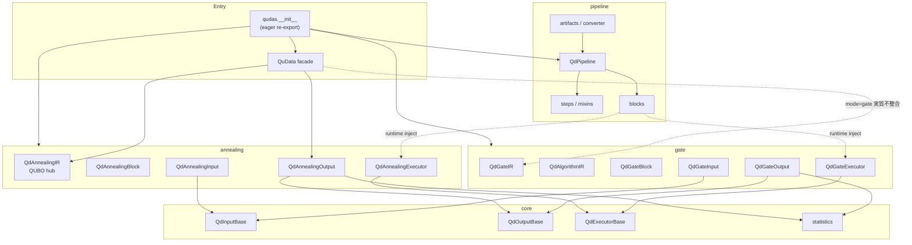

# Architecture

調査日: 2026-09-18 / 版: 0.2.5  
この文書は **CURRENT** を記述し、**TARGET** は Proposed decision のみ記載する。

## 1. System architecture（CURRENT）



## 2. Module boundary（CURRENT）

| Module | Boundary |
|--------|----------|
| `core` | domain-neutral ABC + 統計。backend SDK を import しない |
| `qudata` | 互換ファサード + レガシー変換クラス。新規変換ロジックの主置き場ではない |
| `gate` | 回路表現・Qiskit 変換・実行・測定結果 |
| `annealing` | QUBO 正規形・形式変換・ソルバ実行・結果変換 |
| `pipeline` | 古典／量子ステップのオーケストレーション。Executor 実装を内包しない |

## 3. Dependency direction（CURRENT）

```text
                 qudas.__init__
                        │
        ┌───────────────┼───────────────┐
        ▼               ▼               ▼
      gate          annealing        pipeline
        │               │               │
        └──────► core ◄─┘               │
                                        │
      qudata ──► gate / annealing       │
      (facade)                          │
      pipeline ──(runtime)──► user-provided Executor
```

- **循環依存なし**（`qudata → annealing/gate` はあるが逆方向なし）
- **注意:** `import qudas` は gate/annealing を eager load（SDK は遅延 import のため未インストールでもモジュールロードは可能な設計）

## 4. High-level data flow

### Gate

```text
QdGateIR → QdGateBlock → QdGateInput
       ↘ QdAlgorithmIR ⇄ Qiskit / OpenQASM
QdGateInput → QdGateExecutor.run[.run_split] → QdGateOutput
```

### Annealing

```text
external formats ⇄ QdAnnealingIR → QdAnnealingBlock → QdAnnealingInput
QdAnnealingInput → QdAnnealingExecutor → QdAnnealingOutput
```

### Pipeline

```text
steps (fit/transform/predict/optimize) + optional Iterator/Optimizer
  → (optional) BaseBlock.run → Executor.run
  → models / results / context 共有
```

## 5. Extension model（CURRENT）

| Extension point | Mechanism |
|-----------------|-----------|
| Executor provider | `provider` / `provider_map` / `provider_config*` |
| Pipeline step | `QdBaseStep` 実装を `(name, step)` で登録 |
| Quantum in pipeline | `QuantumBlock(input_obj, executor_cls, ir_builder=None)` |
| Artifact conversion | `ArtifactConverterRegistry`（未登録は `TypeError`） |

## 6. Executor contract（CURRENT）

```text
QdExecutorBase.run(input: QdInputBase) -> QdOutputBase
QdExecutorBase.run_split(input) -> QdOutputBase  # optional; default NotImplementedError
```

Gate/Annealing 具象クラスが provider 解決と SDK 呼び出しを担当。Pipeline はオーケストレーションのみ。

## 7. Pipeline contract（CURRENT）

- `fit` / `optimize` / `predict` は実装あり
- docstring にある `transform` / `fit_transform` の公開メソッド、および `set_params(step__param=...)` のネスト解決は **未実装または不完全**（INTENDED と CURRENT の不一致）
- `set_context` / `global_params` が併存

## 8. Phase 1 Review Notes（2026-09-18）

Architecture Agent レビュー結論:

1. **依存方向は概ね健全** — `core ← gate/annealing`、pipeline 非結合、循環なし。
2. **最大の境界侵食は qudata** — 変換ハブ実体が annealing に移った一方、Public 物語とレガシーが qudata に残る（C-001〜C-003, C-006）。
3. **Pipeline / Executor 責務分担は正しい** — 重複は「文書が Pipeline に sklearn 全機能を約束している」点（C-004, C-005）。
4. **Optional 境界は「SDK 遅延」は守れているが「import 表面」は守れていない**（C-007）。
5. **暗黙契約** — naive fallback（C-012）と `__version__`（C-010）は互換ポリシー未決定。

詳細衝突リスト: `.cursor/docs/conflict-analysis.md`

### Finding priority（実装はしない）

| Pri | Finding | Suggested phase |
|-----|---------|-----------------|
| P0 | QuData 責務再定義 | 3–4 |
| P0 | README Output 例 / gate mode 破綻 | 4 後 or docs-only 先行 |
| P1 | Pipeline 契約の公式化 | 4 |
| P1 | レガシー変換の単一化 | 5–6 |
| P1 | packaging / `__version__` / eager import | 7 |
| P1 | naive fallback 契約 | 4–6 |
| P2 | pre-commit / flake8 / requirements | tooling |

## 9. TARGET（仮説・未決定）

詳細草案: `.cursor/docs/target-architecture.md`（Phase 3）。

初期検討用の依存イメージ（**Accepted ではない**）:

```text
core  → domain-neutral abstraction
qudata →（再定義必須）facade のみ / または廃止して annealing IR を正とする
pipeline → orchestration only
gate / annealing → domain adapters +（annealing）QUBO canonical IR
```

### QuData 選択肢（要約）

| Option | 概要 | Draft |
|--------|------|-------|
| A | 正 = `QdAnnealingIR`、`QuData` は互換 facade | **推奨 → DEC-011 で Accepted** |
| B | 変換を qudata に戻す | 非推奨（変更大） |
| C | QuData 非推奨、IR を直接 Public に | 代替案 |

確定は Phase 4 と `decisions.md` で行う。

### Executor fallback（TARGET — DEC-019）

v0.3: `QdExecutorBase(..., fallback="raise"|"naive")`。デフォルト `"raise"`。`"naive"` は明示時のみ（warning 維持）。`run` には載せない。0.2.x は未実装（warning + 暗黙 naive）。

## 10. Next-gen Additive modules（2026-11-25, DEC-020〜022）

詳細: `.cursor/docs/next-gen-architecture.md`

```text
problem / algorithm / result / exchange / qplat / model
        → pipeline.model + registry
        → annealing / gate（遅延） / core
QdPipeline（runtime） ⇄ QdPipelineModel.materialize()
```

`QdPipeline.models`（学習格納）≠ `QdPipelineModel`（永続化仕様）。
