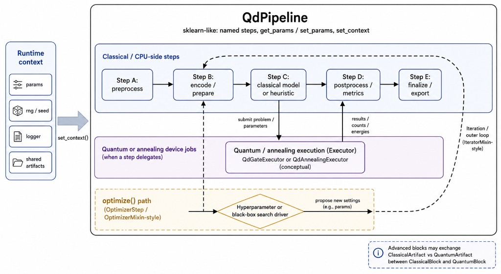
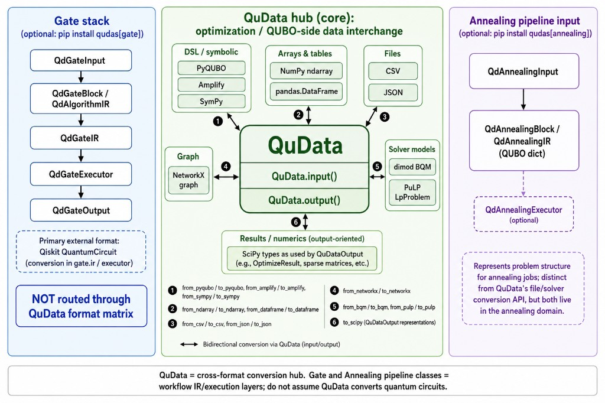

.. Qudas documentation master file, created by
   sphinx-quickstart on Thu Mar 14 05:33:12 2024.
   You can adapt this file completely to your liking, but it should at least
   contain the root `toctree` directive.

Welcome to Qudas's documentation!
=================================

**Qudas** は、量子計算と古典最適化をまたいだワークフローを組み立てるための Python ライブラリです。役割は大きく次の三つに分かれます。

1. **パイプライン** （:class:`~qudas.pipeline.QdPipeline`）
   名前付きステップと ``set_context`` によるランタイム注入で、前処理・古典モデル・後処理などの **古典ステップ列** を記述します。ステップが量子／アニーリング Executor へ問題を委譲し、結果を後段へ返す流れを想定しています。外側の反復（``IteratorMixin``）や最適化（``OptimizerMixin`` / ``OptimizerStep``）から準備段へ戻る経路も置けます。
   **サポートする主な操作:** ``fit`` / ``optimize`` / ``predict`` / ``get_results`` / ``get_models`` / context 系。
   **未サポート:** 公開メソッドとしての ``transform`` / ``fit_transform``、および ``set_params`` の step ネスト指定。

2. **形式変換** （:class:`~qudas.qudata.QuData`）
   最適化・QUBO まわりの表現を ``QuData.input()`` / ``QuData.output()`` で行き来させる **変換専用の Public 入口** です。実装の正は :class:`~qudas.annealing.QdAnnealingIR` / :class:`~qudas.annealing.QdAnnealingOutput` であり、Executor による実行は不要です。量子回路そのものの変換は行いません（回路はゲートスタック側）。

3. **ゲート方式・アニーリング方式（オプション）**  
   ``qudas[gate]`` ではゲート用 Input / Block・IR / Executor / Output（主に Qiskit）。``qudas[annealing]`` ではアニーリング実行用の同様の層に加え、QUBO 変換の canonical 実装（``QdAnnealingIR``）を提供します。変換 API と実行 API は別経路です。

インストールの目安:

* ``pip install qudas`` … コア（NumPy + matplotlib）。``import qudas`` はサブモジュールを eager load します（SDK は遅延 import）
* ``pip install "qudas[annealing]"`` … データ変換 + アニーリング実行用ライブラリ一式
* ``pip install "qudas[gate]"`` … Qiskit ベースのゲート実行
* ``pip install "qudas[all]"`` … 上記をまとめて

詳しい手順とコード例は :doc:`quickstart` を参照してください。

パイプラインの概念図
--------------------

   **QdPipeline** のイメージ。左のランタイムコンテキスト（パラメータ、乱数、ロガー、共有成果物）を ``set_context`` で受け取り、古典ステップの列のなかで量子／アニーリング Executor への委譲や、最適化ループからのフィードバックを表現します。

変換と実行の関係
----------------

   **変換と実行** （現行整理）。``QuData`` / ``QdAnnealingIR`` が QUBO 系の相互変換、青・紫はゲート／アニーリングの実行スタックです。変換のみの利用に Executor は不要です。

.. toctree::
   :maxdepth: 2
   :caption: はじめに

   quickstart

.. toctree::
   :maxdepth: 2
   :caption: コアとデータ変換

   core/index
   qudata/index

.. toctree::
   :maxdepth: 2
   :caption: ゲート方式（オプション）

   gate/index

.. toctree::
   :maxdepth: 2
   :caption: アニーリング方式（オプション）

   annealing/index

.. toctree::
   :maxdepth: 2
   :caption: パイプライン

   pipeline/index

.. toctree::
   :maxdepth: 2
   :caption: リリースノート

   whatsnew_0_2_6
   whatsnew_0_2_5
   whatsnew_0_2_4
   whatsnew_0_2_3
   whatsnew_0_2_2
   whatsnew_0_2_1

.. toctree::
   :maxdepth: 2
   :caption: 参照

   references

「本ライブラリは、国立研究開発法人新エネルギー・産業技術総合開発機構（ＮＥＤＯ）の委託業務の結果得られたものです。」
